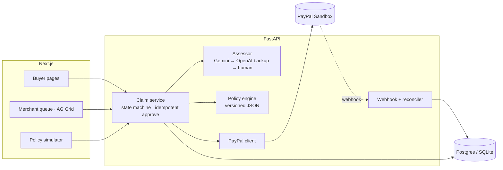

# RefundPilot

**Explainable, auditable refunds for PayPal merchants.** Resolve customer problems before they become disputes.

A buyer reports a damaged item with a photo. A vision model describes what the photos show, a versioned
rule engine turns that into a refund amount under the merchant's own policy, the merchant approves in one click,
and the refund is executed through the PayPal Payments API. Every step lands in an audit trail.

```
Buyer photo ─► AI describes the evidence ─► Policy computes the amount ─► Merchant approves ─► PayPal refunds
                (never sets an amount)        (deterministic, versioned)     (one click)          (idempotent)
```

Built for the [PayPal AI Hackathon](https://paypalaihackathon.devpost.com/) (Oct–Nov 2026).

- **Live demo:** https://refundpilot-web.onrender.com (the merchant token is prefilled there; it can only move PayPal **sandbox** money).
  It runs on free hosting: after 15 idle minutes the first page load can take about a minute while the server wakes up.
- **Video (under 3 min):** https://youtu.be/ClVgMo-wgOM
- **Design doc:** [`docs/DESIGN.md`](docs/DESIGN.md)

## Why this split matters

Letting an LLM decide "how much money to give back" is a bad idea: it can be talked into it, it is not
reproducible, and nobody can explain the result afterwards. RefundPilot gives each layer one job:

| Layer | Job | Can it move money? |
|---|---|---|
| **AI (Gemini vision; optional OpenAI backup)** | Describe the photos with structured observations and uncertainty: does it match the product, what damage is visible, how good is the evidence, what can't be told | No. The model cannot directly set or execute a refund; its output schema has no amount field. Versioned policies calculate the suggestion, and a merchant approves every payment |
| **Policy engine** | Pure function from evidence + order facts to an outcome and amount, using a versioned JSON policy | No, it only suggests |
| **Merchant** | Approve (optionally override within the refundable balance), request more evidence, or reject | Yes, the only path to a refund |
| **PayPal** | Execute the refund on the original capture | Yes, with a fixed `PayPal-Request-Id` per attempt |

## What uses PayPal

- **Orders v2:** `scripts/mint_orders.py` creates and captures the sandbox orders the buyer can claim against.
- **Payments v2:** `GET /v2/payments/captures/{id}` checks the refundable balance before every refund;
  `POST /v2/payments/captures/{id}/refund` executes it; `GET /v2/payments/refunds/{id}` reconciles pending ones.
- **Idempotency:** each refund attempt has a deterministic `PayPal-Request-Id`. A double click produces one refund.
  A timeout puts the refund in `UNKNOWN`, and the reconciler replays the same request id, so PayPal returns the
  original refund instead of paying twice.
- **Webhooks:** `PAYMENT.CAPTURE.REFUNDED` is signature-verified via `/v1/notifications/verify-webhook-signature`,
  deduplicated by event id, and finalizes the refund exactly once.
- The UI shows "Refunded" only when PayPal reports the refund as `COMPLETED`.

## How we tested it

29 predefined claim scenarios plus a 12-case held-out set, each run 3 times through the real Gemini assessor and
policy engine (`cd backend && python -m eval.run_eval`). The first run found a real hole: a reused screenshot of someone
else's damage photo incorrectly received a full-refund recommendation. Policy 1.2 fixed it. After that, the main set passed 87 of 87 runs and the
held-out set, whose expected outcomes were committed before its photos existed, passed 36 of 36 runs; neither had a
suggestion above its predefined cap. Results, failures and limits: [docs/EVALUATION.md](docs/EVALUATION.md),
[docs/EVALUATION-heldout.md](docs/EVALUATION-heldout.md).

## Architecture



## Run it locally

Requirements: Python 3.11+, Node 20+. Works with **no credentials at all**: without PayPal keys the backend seeds
8 demo orders on an in-memory fake gateway, and without AI keys it uses a canned assessor.

```bash
# backend
cd backend
python -m venv .venv && . .venv/bin/activate      # Windows: .venv\Scripts\activate
pip install -e ".[dev]"
cp .env.example .env                              # optional: PayPal sandbox + Gemini keys
uvicorn app.main:app --reload                     # http://127.0.0.1:8000/docs

# frontend (second terminal)
cd frontend
npm ci
cp .env.example .env.local
npm run dev                                       # http://localhost:3000
```

`GET /health` tells you which PayPal gateway and AI provider are active. The merchant pages ask for
`MERCHANT_TOKEN`: locally that's `change-me` (in `backend/.env`). A deployed API refuses to start with an empty or
default token; `render.yaml` generates a random one.

To use the real PayPal sandbox, fill `PAYPAL_CLIENT_ID` / `PAYPAL_CLIENT_SECRET`, then mint captured orders:

```bash
cd backend && python scripts/mint_orders.py --count 8            # one link at a time
cd backend && python scripts/mint_orders.py --count 30 --batch   # all links at once, pay them in browser tabs
```

Each order prints an approval link; pay it with a sandbox Personal account and the script captures it and appends it
to `backend/seed/orders.json`. Restart the API to load new orders.

## Try the demo

1. **1-click sample scenarios** (`/`): the top of the home page offers three 1-click presets (**Clearly broken item**, **Blurry photo**, and **Suspected reused screenshot**) that automatically select a claimable order and pre-fill the test photo and buyer description—no file download needed. Click **Submit claim** to run the live Gemini assessment and policy engine.
2. Watch the claim page: the evidence card fills in, then the decision card shows the rule, amount and policy version.
3. **Merchant** (`/merchant`): open the claim from the queue, approve. The PayPal refund id appears and the status
   turns `COMPLETED`. (Click **All claims** on the merchant page to inspect already-completed and hard-case claims; the default **Open** filter shows only pending claims.)
4. **Policy simulator & batch replay** (`/merchant/policy`): test how the same evidence—or a batch of 6 representative cases / recorded claims—plays out across Standard, Strict, and Goodwill policies (total suggested payout, review/evidence rate, and per-case rule diffs) before adopting a policy.

### Notes for judges

- **Each order can be claimed once.** A second claim on the same order is caught by the policy's repeat rule
  (`PRE-repeat`) and goes to manual review with no suggested amount, and a fully refunded order can't be claimed at
  all. The buyer page lists the orders you can still use first and marks the rest *Already claimed*.
- **Everything is PayPal sandbox.** The merchant token is public on the demo on purpose, so you can skip sign-in; the
  most it can do is refund sandbox money that was paid in for this demo.
- **Delivery dates roll forward.** The sandbox orders were paid in early November. To keep the 14-day report window
  open while you test, an order nobody has claimed yet always shows as delivered 3 days ago (`DEMO_ROLLING_DELIVERY`,
  demo only). Orders with a claim keep their dates, so recorded decisions stay reproducible.
- **Abuse limits.** Each submission costs one AI call, so the public demo allows 5 submissions per minute per IP and
  200 AI assessments per day (`CLAIMS_PER_IP_PER_MINUTE`, `AI_CALLS_PER_DAY`). You'll see HTTP 429 past that.
- **Free hosting.** The demo runs on Render's free plan with a free Neon database. During the judging window a
  scheduled GitHub Action ([`keep-demo-awake.yml`](.github/workflows/keep-demo-awake.yml)) keeps it awake; outside
  it, the first request after 15 idle minutes can take about a minute while the server wakes up.

## Tests

```bash
cd backend && pytest -q
```

Covers every policy rule, the claim state machine, and idempotent approval: double click, PayPal error then retry,
timeout then reconcile with the same request id, and a PENDING refund finalized exactly once by a webhook. Also the
demo guards: rolling delivery dates, rate limits, token checks, first boot on an empty database.

## Tech and sponsor tools

- **PayPal** Orders v2, Payments v2 (captures, refunds), Webhooks, sandbox
- **Gemini** (`google-genai`, `response_schema`) for the vision assessment; **OpenAI** structured outputs as an
  optional automatic backup when `OPENAI_API_KEY` is set
- **AG Grid** Community: the merchant claims queue (custom cell renderers, Quartz theme)
- **Render**: `render.yaml` blueprint deploys the API and the web app in one step (free plan, Frankfurt);
  the database is a free Neon Postgres passed in as `DATABASE_URL`
- **APIMatic** _(planned)_: API docs and SDKs generated from the FastAPI `openapi.json`
- FastAPI, SQLAlchemy 2, Next.js 15, Tailwind CSS 4

## License

[MIT](LICENSE)
